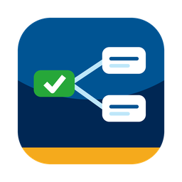

<p align="center">
  
</p>

<h1 align="center">UVic Course Mapping</h1>

<p align="center">
  Plan your UVic degree: see which courses you've unlocked, what you still need, and a flowchart of how it all connects.
</p>

## Quick start

### 1. Download

| Your computer | Download |
| --- | --- |
| **Mac** (M1, M2, M3, M4…) | [**Download for Mac**](https://github.com/bennichols02/UVic-Course-Mapping/releases/latest/download/UVic-Course-Mapping-macOS.zip) |
| **Windows** | [**Download for Windows**](https://github.com/bennichols02/UVic-Course-Mapping/releases/latest/download/UVic-Course-Mapping-Windows.exe) |

Older Intel Mac? Use [this download](https://github.com/bennichols02/UVic-Course-Mapping/releases/latest/download/UVic-Course-Mapping-macOS-Intel.zip) instead.

You don't need to install anything else. The app comes with all UVic course data built in.

### 2. Open it

**Mac**
1. Open your **Downloads** folder and double-click **UVic Course Mapping**.
2. The first time, macOS will warn you that it can't verify the app. Click **Done**.
3. Open **System Settings → Privacy & Security**, scroll down, and click **Open Anyway** next to "UVic Course Mapping".
4. After that, just double-click it like any other app. You can drag it into your **Applications** folder to keep it.

**Windows**
1. Double-click **UVic-Course-Mapping-Windows.exe** in your Downloads folder.
2. If you see "Windows protected your PC", click **More info → Run anyway**.

> These warnings appear because this is a free student project and isn't paid-signed by Apple or Microsoft. The app doesn't connect to the internet.

### 3. Use it

1. Click **Enter Course Planning Space**.
2. Go to **My Plan** and add the courses you've completed (for example `CSC 110, MATH 100`).
3. Explore:
   - **Unlocked**: courses that list a given course as a prerequisite
   - **Flowchart**: a visual map of your progress and what's available next
   - **Details / Prereqs**: look up any UVic course
   - **Targets**: courses you want to take, and what you need first
   - **Notes**: your own planning notes

Everything you add is saved automatically on your computer and stays private to you.

## Feedback

This is an early test version. Bugs, wrong prerequisites, or ideas? [Open an issue](https://github.com/bennichols02/UVic-Course-Mapping/issues) and let me know.

> Course data is a snapshot of the UVic undergraduate calendar. Always double-check prerequisites in the [official UVic calendar](https://www.uvic.ca/calendar/undergrad/) before registering. This project is not affiliated with the University of Victoria.

---

<details>
<summary>For developers: run from source</summary>

Requires Python 3.10+ with Tk (on a Homebrew Python, run `brew install python-tk`).

```bash
python3 course_gui.py                 # the app
python3 course-mapping.py "CSC 225"   # command line: which courses need CSC 225
```

Saved data lives in `~/Library/Application Support/UVic Course Mapping` (Mac) or `%APPDATA%\UVic Course Mapping` (Windows).

The flowchart uses [Graphviz](https://graphviz.org/) for its layout when `dot` is installed, and falls back to a built-in layout otherwise.

**Releasing:** push a version tag (`git tag v0.1.0 && git push origin v0.1.0`). The GitHub Actions workflow builds the Mac and Windows apps and attaches them to a new release, which the download links above always point to.

</details>
